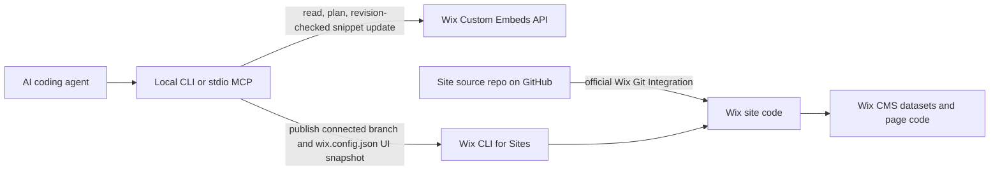

# Wix Site Bridge

A small, local tool for coding agents to manage a Wix site through ordinary Git, the documented Wix Custom Embeds API, and Wix CLI for Sites. The bridge is shared tooling. Each adopted Wix site keeps its own, officially connected source repository.

The bridge does not use browser cookies, copied editor sessions, private Wix endpoints, or arbitrary editor automation. It does not replace Wix CMS datasets or store runtime content outside Wix.



## Page delivery

CrawlSEO delivers a Wix page as a custom element placed in the page (sized per
breakpoint), a `HEAD` early packet that registers it before Wix's loader, and
the page code that relays its height. The bridge creates and rewrites the packet
entries; the human places and sizes the element, because Wix has no API for
editor elements. A `BODY_END` mount is a prototype lane, not delivery. Read
[Page delivery](docs/PAGE_DELIVERY.md) before touching a delivered page or
writing any other document about how pages are delivered.

## Current status

- Local CLI and MCP adapter, deterministic packet generation, Custom Embed
  create/read/update/disable, snapshot, release, verification, and snippet
  rollback are implemented.
- Atelier Harmonie and SusiMacDonald each keep their own manifest, connected
  repository and customer documents under `sites/`. Current release state is
  recorded in each site's `production/deployment-record.json` and private
  receipts; this README is not a release log.
- `sites/atelier-harmonie/site.manifest.json` selects Atelier Harmonie
  explicitly. The exact site ID is also recorded in `.env.example` for the
  required `WIX_ALLOWED_SITE_IDS` boundary.
- The Wix CLI for Sites (`@wix/cli` 1.1.263) is installed locally in the
  ignored `.wix-cli/` directory. The connected Atelier source repository is
  `weareheadless/atelier-harmonie`; the older `chocholesmarrons` connection is
  not used. See `sites/atelier-harmonie/AGENTS.md` and its production documents.
- `site-agent` is a separate generic content manager and is not the Wix bridge.


## Multiple customer websites

Shared bridge tooling stays in `src/`. Customer code, manifests and instructions live in `sites/<alias>/`; see [customer layout](sites/README.md). Atelier’s approved design and staged production components are in `sites/atelier-harmonie/`. Pages are delivered through the connected repository and the packet + mount pair, not through editor placement. Root `site.manifest.json` is a compatibility symlink for historical local recovery commands, not a second manifest.

## Prerequisites

- GitHub access to the **private** `weareheadless/wix-site-bridge` repository.
- A separate Wix site source repository created and connected by **Wix Git Integration & Wix CLI for Sites**. An unrelated GitHub repository is not a substitute. The connected editor syncs code from its configured default branch and becomes read-only for code edits after connection. See [About Git Integration with Wix CLI](https://dev.wix.com/docs/develop-websites-sdk/code-your-site/developer-environments/ides/git-integration/about-git-integration-with-wix-cli) and [Set Up Git Integration](https://dev.wix.com/docs/develop-websites-sdk/code-your-site/developer-environments/ides/git-integration/set-up-git-integration-with-wix-cli).
- Git, Node.js 20.11 or later, npm or yarn, and an SSH key configured for GitHub for the Wix-connected source repo. Install Wix CLI for Sites as shown in the official setup guide.
- A local clone of the site source repository. Keep this repo separate from the bridge repo.
- For Custom Embeds, a Wix app installed on the selected site, the app scope `SCOPE.EDITOR.MANAGE_CUSTOM_EMBEDS`, and the app credentials described below.
- For publishing, the Wix CLI logged in locally with `wix login`, or a narrowly scoped API key for Wix CLI for Sites.

This repository itself has no runtime package dependencies. `npm test` uses Node's built-in test runner.

## Wix APIs and their boundaries

### Git Integration and Wix CLI for Sites

Git Integration is the supported Wix code workflow: the site's code is associated with a GitHub repository and its default branch. `wix publish` asks whether to publish the latest commit from that branch or local code. In both CLI paths, Wix uses the saved UI version referenced by `wix.config.json`; publishing from the editor instead uses the latest UI version, which may not match the repository. The bridge therefore checks the site ID in `wix.config.json`, requires a clean checkout on the configured default branch, requires local `HEAD` to equal `origin/<defaultBranch>`, and records the SHA-256 of `wix.config.json` in the release receipt. The user completes Wix's CLI prompt. See [Publish a Site with Git Integration & Wix CLI](https://dev.wix.com/docs/develop-websites-sdk/code-your-site/developer-environments/ides/git-integration/publish-a-site-with-git-integration-and-wix-cli).

The official **Publish Site** SDK action also exists. It publishes saved changes and uses the `Manage SEO Settings` permission for the documented SDK path; an API-key request uses `wix-site-id`. Its method contract does not select a Git commit or UI snapshot, so this bridge does not use it to publish a Git-integrated release. See [Publish Site](https://dev.wix.com/docs/sdk/account-level-modules/sites/site-actions/publish-site).

### Custom Embeds API

The Custom Embeds API manages dashboard code snippets at `HEAD`, `BODY_START`, or `BODY_END`. These are not canvas HTML embed elements or general editor layout APIs. The API supports list, get, create, update, and delete operations; the bridge creates new embeds and reads or updates existing ones, including the CrawlSEO entries that no manifest lists. List supports cursor paging with a maximum of 100 items per request. The documented custom embed name length is 1–100 characters. The API object marks `pageFilter` read-only, so new API-created embeds apply to all pages. To make a prototype safe, `create-snippet` and `update-snippet` require an exact non-root route; pass `--all-pages` only for a self-guarding CrawlSEO entry. For a single embed, the wrapper waits for Wix's page content to settle and replaces the content of `#PAGES_CONTAINER`, `#main_MF`, or the semantic `main` container; the site's native header and footer stay in place. For stacked sections, each manifest entry declares a unique `mountId` and stable `mountOrder`. Each section appends to the shared prototype root and the bridge sorts sections by that order, regardless of which API snippet loads first. Every section should be self-contained and use the same exact route guard. Pass both `--mount-id` and `--mount-order` when creating each stacked embed. The bridge compresses the supplied HTML before sending it to Wix, then restores it in the visitor's browser with the widely available `DecompressionStream` API. If decoding fails or the page content does not settle, it leaves the existing page content unchanged. The API page scope itself remains site-wide, and the bridge reports that explicitly. Creating the Wix page itself and hiding it from site navigation are separate Wix Editor actions; they are not Custom Embeds API operations. A page hidden from navigation is still public to anyone with its URL. The API schema pages reviewed here don't list an HTML-body size limit; deployments still fail closed on any Wix API rejection. Categories affect consent/loading behavior; category changes must be declared in the manifest and `--from-category` must match the current live category. See [Create Custom Embed](https://dev.wix.com/docs/api-reference/business-management/custom-embeds/create-custom-embed), [Custom Embed Object](https://dev.wix.com/docs/api-reference/business-management/custom-embeds/custom-embed-object), and [DecompressionStream](https://developer.mozilla.org/en-US/docs/Web/API/DecompressionStream).

The wrapper described above is the prototype/fallback HTML embed lane, used by a
site with no connected repository. A CrawlSEO-delivered page uses bare script
entries instead: `HEAD` early packets named `CrawlSEO early packet — <tag> — <n>`
that register the custom element and preload its hero. They carry their own
route and language guard, so they are created with `--all-pages`; the human may
narrow their page scope in the Custom Code panel. There is no mount for a placed
element. See [Page delivery](docs/PAGE_DELIVERY.md) for the full rule set.

An update must include the current `revision`. The bridge does one read, sends one update with that revision, and never retries a conflict automatically. Wix documents that a Custom Embed update is applied on the next site render; it does not wait for a site publish. See [Custom Embeds API reference and sample flows](https://dev.wix.com/docs/api-reference/business-management/custom-embeds/create-custom-embed), [Update Custom Embed](https://dev.wix.com/docs/api-reference/business-management/custom-embeds/update-custom-embed), and [Custom Embed Object](https://dev.wix.com/docs/api-reference/business-management/custom-embeds/custom-embed-object).

Custom Embed methods require a **Wix app or Wix user identity** and `SCOPE.EDITOR.MANAGE_CUSTOM_EMBEDS`. Wix API-key authentication is not accepted for these methods. This bridge uses an installed Wix app identity and the official OAuth `client_credentials` token endpoint; tokens are cached in memory for less than their four-hour lifetime. The OAuth token flow and its `instance_id` requirement are documented in [Create Access Token](https://dev.wix.com/docs/api-reference/app-management/oauth-2/request-an-access-token) and [REST API Authentication](https://dev.wix.com/docs/api-reference/articles/rest-authentication/rest-api-authentication).

### Credentials

Create or configure a Wix app in Wix Dev Center, add the `SCOPE.EDITOR.MANAGE_CUSTOM_EMBEDS` permission, and install it on the selected site. Store its app ID, secret, and installed app instance ID in a local secret manager or the process environment:

```sh
export WIX_APP_ID="<app-id>"
export WIX_APP_SECRET="<app-secret>"
export WIX_APP_INSTANCE_ID="<installed-instance-id>"
export WIX_ALLOWED_SITE_IDS="<exact-wix-site-id>"
```

The instance ID is available from the Wix `Instance App Installed` event for that installation. Do not put these values in a manifest, source file, issue, or chat. The bridge never prints or writes the app secret or access token.

Static-page SEO settings use a different credential. Create a Wix API key with `Manage SEO Settings` (`SCOPE.PROMOTE.MANAGE-SEO`) and store it as `WIX_SEO_API_KEY`. The app-instance token used by Custom Embeds is not accepted by the Item SEO Tags API. The bridge never prints or writes the key.

```sh
export WIX_SEO_API_KEY="<wix-api-key-with-manage-seo>"
```

The site publishing key is separate. For CI, Wix documents a site permission named **Wix CLI for Sites - Git Integration**. Configure it as a repository/CI secret and authenticate using the supported Wix CLI `wix login --api-key` flow. Do not use that key for Custom Embeds. Locally, `wix login` can use the Wix CLI's own authentication store. See [Set Up GitHub Actions for Wix CLI for Sites](https://dev.wix.com/docs/develop-websites-sdk/code-your-site/developer-environments/ides/git-integration/set-up-git-hub-actions).

`WIX_ALLOWED_SITE_IDS` is mandatory for every operation. It is a comma-, semicolon-, or whitespace-separated list of exact IDs. It must include the one site ID in the selected manifest. Every command and tool also requires the explicit `--site` alias (or MCP `site` argument). Placeholder IDs, alias mismatches, unknown snippet IDs, and sites outside the allowlist are refused.

## New-site onboarding

1. Create the new Wix site and connect it to a **separate site source repository** using Wix's Git Integration setup. Save editor UI changes so the repository's `wix.config.json` represents the UI snapshot intended for code publishing.
2. Clone that connected repo. Record its owner/repository, default branch, Wix site ID (from the dashboard URL), public routes, custom element tags, Wix element IDs, dataset bindings, and the IDs, positions, categories, load-once setting, and page scopes of any dashboard Custom Embeds.
3. Make a site-specific copy of `examples/new-site.manifest.json`. Fill in those details and keep this bridge's `WIX_ALLOWED_SITE_IDS` limited to the test site's ID. Add only Custom Embeds the site actually uses. A site whose pages are delivered by CrawlSEO does not need the example snippet mapping; each delivered page gets its own packets through the delivery lane (see [Page delivery](docs/PAGE_DELIVERY.md)).
4. A CrawlSEO-delivered page needs a published Wix page at its route with the custom element **placed and sized in the editor** (element and containing section, desktop and mobile). The packets only register it early. There is no API to add, size or position an editor element, and a `BODY_END` mount is a prototype lane that cannot meet the performance contract: it must move the element out of its sized section, rebuilds the page after first paint and costs CLS. Record the Wix element id and section id in the manifest, and connect the existing page code.
5. Export credentials locally. Run the commands below from the bridge repository, passing the local path to the Wix-connected site source repo.
6. After a release, verify snippet hashes, inspect a fresh live DOM, and review desktop and mobile renderings. Fix any issue before calling the deployment visually verified.

The example component is a vanilla browser Custom Element at `examples/site-source/src/public/custom-elements/property-card.js`. The example manifest records the route, tag, Wix element ID, and intended dataset binding. The artifact generator compresses that same source to a deterministic gzip/base64 `<script>` packet; the example output is `examples/generated/wh-property-card.html`. The packet uses `DecompressionStream` and dynamic evaluation, so its browser/CSP behavior must be validated on the actual test site. The example is a reference build. A CrawlSEO-delivered page does not depend on a manifest mapping: it gets its packets through the delivery lane described in [Page delivery](docs/PAGE_DELIVERY.md), and its element is placed in the page.

Regenerate the checked-in example packet after editing the component source:

```sh
npm run example:build
```

## CLI workflow

From the bridge checkout, after copying and completing a site manifest:

```sh
export WIX_ALLOWED_SITE_IDS="<exact-wix-site-id>"

# API-created prototypes are dry-run by default and require an exact route guard.
npm run bridge -- create-snippet \
  --manifest ./sites/atelier-harmonie/site.manifest.json \
  --site atelier-harmonie \
  --name "Atelier Harmonie Prototype" \
  --html-file ./prototype/home.html \
  --route /accueil-prototype

# After reviewing the plan, --apply calls Wix Create Custom Embed and saves a private receipt.
npm run bridge -- create-snippet \
  --manifest ./sites/atelier-harmonie/site.manifest.json \
  --site atelier-harmonie \
  --name "Atelier Harmonie Prototype" \
  --html-file ./prototype/home.html \
  --route /accueil-prototype \
  --position BODY_END \
  --category FUNCTIONAL \
  --apply

# Update an existing manifest-declared embed. The command makes a private
# rollback snapshot and uses the embed's current revision.
npm run bridge -- update-snippet \
  --manifest ./sites/atelier-harmonie/site.manifest.json \
  --site atelier-harmonie \
  --snippet <custom-embed-id> \
  --html-file ./sites/atelier-harmonie/prototype/01-hero.html \
  --route /copy-of-accueil \
  --apply

# For an intentional consent-category change, update the manifest's category
# first and pass the current live category explicitly.
npm run bridge -- update-snippet \
  --manifest ./sites/atelier-harmonie/site.manifest.json \
  --site atelier-harmonie \
  --snippet <custom-embed-id> \
  --html-file ./sites/atelier-harmonie/prototype/01-hero.html \
  --route /copy-of-accueil \
  --category ESSENTIAL \
  --from-category FUNCTIONAL \
  --apply

# Rewrite one CrawlSEO early packet or page mount in place, by embed id.
# Only names starting with "CrawlSEO early packet" or "CrawlSEO page mount"
# are accepted; the current revision and page scope are preserved.
# Pass --load-once false so the entry also runs on an internal navigation.
npm run bridge -- write-packet \
  --manifest ./sites/atelier-harmonie/site.manifest.json \
  --site atelier-harmonie \
  --snippet <custom-embed-id> \
  --html-file ./packet.html \
  --load-once false \
  --apply

# Read or set a static page's SEO title and meta description. The page is
# matched by the canonical URL its SEO tags already carry, because the API does
# not return page URLs. --apply publishes the existing page revision; it never
# publishes the whole site. Requires WIX_SEO_API_KEY. The API covers the site's
# primary language only; a translated page's SEO is an editor setting.
npm run bridge -- seo-tags \
  --manifest ./sites/atelier-harmonie/site.manifest.json \
  --site atelier-harmonie \
  --route /agenda-artisans-normandie \
  --title "Page title | Site name" \
  --description "The page description." \
  --apply

# Publish the site's saved revision. Custom Embed writes are drafts until a
# publish, and publishing restores page settings from that revision, so the
# command reads each page's own title/description first and writes them back
# afterwards. Requires WIX_SEO_API_KEY.
npm run bridge -- publish-site \
  --manifest ./sites/atelier-harmonie/site.manifest.json \
  --site atelier-harmonie \
  --apply

# Disable an embed CrawlSEO created, for example an older HTML embed that a
# delivered element has replaced. Refuses any non-CrawlSEO embed.
npm run bridge -- disable-embed \
  --manifest ./sites/atelier-harmonie/site.manifest.json \
  --site atelier-harmonie \
  --snippet <custom-embed-id> \
  --apply

npm run bridge -- doctor \
  --manifest ./sites/atelier-harmonie/site.manifest.json \
  --site new-test-site \
  --site-repo /path/to/the/wix-connected-source-repo

npm run bridge -- build \
  --manifest ./sites/atelier-harmonie/site.manifest.json \
  --site new-test-site \
  --site-repo /path/to/the/wix-connected-source-repo

npm run bridge -- plan \
  --manifest ./sites/atelier-harmonie/site.manifest.json \
  --site new-test-site \
  --site-repo /path/to/the/wix-connected-source-repo

# One concise release: Wix CLI publishes first, then the bridge updates snippets.
npm run bridge -- release \
  --manifest ./sites/atelier-harmonie/site.manifest.json \
  --site new-test-site \
  --site-repo /path/to/the/wix-connected-source-repo \
  --apply

npm run bridge -- verify \
  --manifest ./sites/atelier-harmonie/site.manifest.json \
  --site new-test-site \
  --site-repo /path/to/the/wix-connected-source-repo

# Roll back snippets only, after checking the release receipt.
npm run bridge -- restore \
  --manifest ./sites/atelier-harmonie/site.manifest.json \
  --site new-test-site \
  --snapshot <release-id> \
  --apply
```

All mutations are dry-run unless `--apply` is present. `plan`, `build`, `publish`, and `release` check that the site repo is clean, on its configured default branch, at the exact remote-tracking commit, and has a matching `wix.config.json` site ID. The CLI's interactive confirmation remains visible; it is not automated by browser or prompt scraping.

`build --apply` writes the packet to `.wix-bridge-state/artifacts/` by default. `snapshot --apply` saves exact prior Custom Embed contents. State files are ignored by Git and written with owner-only permissions. Release receipts contain source commit, `wix.config.json` hash, snippet revisions and hashes, outcome, and recovery ID; they do not contain snippet HTML or credentials.

## MCP configuration

Run the local stdio server with Node. A generic MCP client configuration looks like:

```json
{
  "mcpServers": {
    "wix-site-bridge": {
      "command": "node",
      "args": ["/absolute/path/to/wix-site-bridge/src/mcp.mjs"],
      "env": {
        "WIX_ALLOWED_SITE_IDS": "<exact-wix-site-id>"
      }
    }
  }
}
```

Inject `WIX_APP_ID`, `WIX_APP_SECRET`, `WIX_APP_INSTANCE_ID`, and optionally `WIX_CLI_API_KEY` from the MCP host's approved secret store or process environment; do not place actual secret values in this checked-in configuration. MCP tools expose inspect, list/read snippets, artifact build, plan, snapshot, deploy, release, publish, verify, and restore. `apply` defaults to `false` on mutation tools. The Wix CLI's publish step is interactive, so MCP `publish` and `release` tools return the exact local terminal command when `apply=true`; run that command in a terminal to complete the release. MCP can apply Custom Embed deploy/restore operations directly when explicitly passed `apply=true`.

## Release ordering and recovery limits

Code publishing and Custom Embed updates are non-atomic. A release records a private snapshot before publishing, publishes the already pushed and selected Wix branch through `wix publish`, then updates each configured snippet with its current revision. This ordering puts compatible Wix code live before the new snippet packet. Snippet updates can affect the next render immediately.

- If code publishing fails, the bridge leaves snippets unchanged and records a `publish-failed` receipt.
- If a snippet update fails after code publishing, the receipt says `partial`, lists applied snippets, and points to a snapshot. Restore checks that current HTML still matches either the saved pre-release state or the intended release state. It restores only the snippets changed by that release and uses each current revision. It refuses to overwrite intervening edits or retry revision conflicts.
- Snippet rollback is supported because previous snippet contents are saved locally. Keep `.wix-bridge-state` private and back it up according to your normal secret/data handling policy.
- Code rollback is not automatic. Use a Git revert on the Wix-connected default branch and publish that commit with `wix publish`, or restore a Wix Site History version through Wix's supported flow. A Git revert does not undo runtime CMS data; Site History also does not restore database collection data. See [About Site History](https://dev.wix.com/docs/develop-websites-sdk/publish-your-site/site-history/about-site-history).
- The API `verify` command checks current embed hashes and can check a configured URL's HTTP status. It does not inspect the browser DOM or take desktop/mobile screenshots. A successful API/hash check alone is not proof the visible deployment works.

## SusiMacDonald

SusiMacDonald is a separate authorized target with its own site ID, credentials
and connected source repository (`weareheadless/susimacdonald-wix`). Its
manifest, embed inventory and translation documents are in
`sites/susimacdonald/`. Never substitute Atelier's identity, credentials or
source for it, and never batch-deploy across the two customers.

## Supported and unsupported operations

Supported: manifest validation, target inspection, Custom Embed list/read/create/update, in-place CrawlSEO packet rewrite (`write-packet`; the prototype mount lane uses the same write path), disabling replaced CrawlSEO embeds (`disable-embed`), deterministic component packet generation, plan/diff, private snapshot, revision-checked snippet deploy, selected-branch Wix CLI publish, concise code-plus-snippet release, hash/HTTP verification, snippet rollback, static-page SEO title/description through `seo-tags` (Item SEO Tags API), and a site publish through `publish-site` (Site Publisher API) so Custom Embed drafts reach the live page.

Unsupported through the bridge: deleting Custom Embeds; changing snippet placement or page filter; creating Wix pages or changing their menu visibility/access rules; adding/repositioning Wix editor elements; changing page layout or dataset wiring through a fabricated API; pushing site source commits on the user's behalf; CMS record/schema mutation; atomic code-plus-snippet deployment; automated visual approval; and automatic code rollback. Page title and meta description are supported; page creation, navigation placement and menu visibility are still editor actions. Use Wix's editor for page setup and the explicitly documented one-time native placement; use supported Git/Wix CLI workflows for site code.

## Local validation

```sh
npm test
```

Tests cover deterministic artifact generation, target allowlisting, redaction, private snapshot permissions, token exchange and scope headers, revision conflicts, paging, dry-run behavior, partial update recovery, overwrite protection, release ordering, publish failure handling, CrawlSEO packet and mount rewriting, and MCP stdio registration. These are local tests with simulated Wix responses; they are not evidence of a live Wix deployment.
