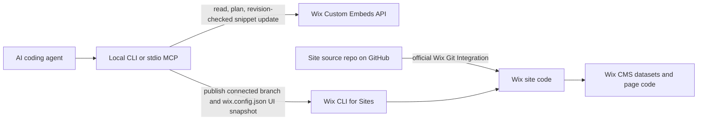

# Wix Site Bridge

A small, local tool for coding agents to manage a Wix site through ordinary Git, the documented Wix Custom Embeds API, and Wix CLI for Sites. The bridge is shared tooling. Each adopted Wix site keeps its own, officially connected source repository.

The bridge does not use browser cookies, copied editor sessions, private Wix endpoints, or arbitrary editor automation. It does not replace Wix CMS datasets or store runtime content outside Wix.



## Current status

- Local CLI and MCP adapter, deterministic packet generation, Custom Embed create/read/update, snapshot, release, verification, and snippet rollback are implemented.
- `site.manifest.json` selects Atelier Harmonie explicitly. The exact site ID is also recorded in `.env.example` for the required `WIX_ALLOWED_SITE_IDS` boundary.
- The Wix CLI for Sites (`@wix/cli` 1.1.263) is installed locally in the ignored `.wix-cli/` directory. The site does not yet have a connected Wix source repository, and no Custom Embeds app credentials are configured.
- No live Wix API mutation or publish has been run. Live DOM inspection and desktop/mobile visual review are still required before calling a visible change verified.
- `site-agent` is a separate generic content manager and is not the Wix bridge. The existing `susimacdonald-rentals` repository is not used or changed here.

## Prerequisites

- GitHub access to the **private** `weareheadless/wix-site-bridge` repository.
- A separate Wix site source repository created and connected by **Wix Git Integration & Wix CLI for Sites**. An unrelated GitHub repository is not a substitute. The connected editor syncs code from its configured default branch and becomes read-only for code edits after connection. See [About Git Integration with Wix CLI](https://dev.wix.com/docs/develop-websites-sdk/code-your-site/developer-environments/ides/git-integration/about-git-integration-with-wix-cli) and [Set Up Git Integration](https://dev.wix.com/docs/develop-websites-sdk/code-your-site/developer-environments/ides/git-integration/set-up-git-integration-with-wix-cli).
- Git, Node.js 20.11 or later, npm or yarn, and an SSH key configured for GitHub for the Wix-connected source repo. Install Wix CLI for Sites as shown in the official setup guide.
- A local clone of the site source repository. Keep this repo separate from the bridge repo.
- For Custom Embeds, a Wix app installed on the selected site, the app scope `SCOPE.EDITOR.MANAGE_CUSTOM_EMBEDS`, and the app credentials described below.
- For publishing, the Wix CLI logged in locally with `wix login`, or a narrowly scoped API key for Wix CLI for Sites.

This repository itself has no runtime package dependencies. `npm test` uses Node's built-in test runner.

## Wix APIs and their boundaries

### Git Integration and Wix CLI for Sites

Git Integration is the supported Wix code workflow: the site's code is associated with a GitHub repository and its default branch. `wix publish` asks whether to publish the latest commit from that branch or local code. In both CLI paths, Wix uses the saved UI version referenced by `wix.config.json`; publishing from the editor instead uses the latest UI version, which may not match the repository. The bridge therefore checks the site ID in `wix.config.json`, requires a clean checkout on the configured default branch, requires local `HEAD` to equal `origin/<defaultBranch>`, and records the SHA-256 of `wix.config.json` in the release receipt. The user completes Wix's CLI prompt. See [Publish a Site with Git Integration & Wix CLI](https://dev.wix.com/docs/develop-websites-sdk/code-your-site/developer-environments/ides/git-integration/publish-a-site-with-git-integration-and-wix-cli).

The official **Publish Site** SDK action also exists. It publishes saved changes and uses the `Manage SEO Settings` permission for the documented SDK path; an API-key request uses `wix-site-id`. Its method contract does not select a Git commit or UI snapshot, so this bridge does not use it to publish a Git-integrated release. See [Publish Site](https://dev.wix.com/docs/sdk/account-level-modules/sites/site-actions/publish-site).

### Custom Embeds API

The Custom Embeds API manages dashboard code snippets at `HEAD`, `BODY_START`, or `BODY_END`. These are not canvas HTML embed elements or general editor layout APIs. The API supports list, get, create, update, and delete operations; the bridge supports creating new embeds and reading/updating IDs already listed in a site's manifest. List supports cursor paging with a maximum of 100 items per request. The documented custom embed name length is 1–100 characters. The API object marks `pageFilter` read-only, so new API-created embeds apply to all pages. To make a prototype safe, `create-snippet` requires an exact non-root route and wraps the HTML so it only replaces page content on that route. The API page scope itself remains site-wide, and the bridge reports that explicitly. The API schema pages reviewed here don't list an HTML-body size limit; deployments still fail closed on any Wix API rejection. Categories affect consent/loading behavior and are preserved. See [Create Custom Embed](https://dev.wix.com/docs/api-reference/business-management/custom-embeds/create-custom-embed) and [Custom Embed Object](https://dev.wix.com/docs/api-reference/business-management/custom-embeds/custom-embed-object).

An update must include the current `revision`. The bridge does one read, sends one update with that revision, and never retries a conflict automatically. Wix documents that a Custom Embed update is applied on the next site render; it does not wait for a site publish. See [Custom Embeds API reference and sample flows](https://dev.wix.com/docs/api-reference/business-management/custom-embeds/create-custom-embed), [Update Custom Embed](https://dev.wix.com/docs/api-reference/business-management/custom-embeds/update-custom-embed), and [Custom Embed Object](https://dev.wix.com/docs/api-reference/business-management/custom-embeds/custom-embed-object).

Custom Embed methods require a **Wix app or Wix user identity** and `SCOPE.EDITOR.MANAGE_CUSTOM_EMBEDS`. Wix API-key authentication is not accepted for these methods. This bridge uses an installed Wix app identity and the official OAuth `client_credentials` token endpoint; tokens are cached in memory for less than their four-hour lifetime. The OAuth token flow and its `instance_id` requirement are documented in [Create Access Token](https://dev.wix.com/docs/api-reference/app-management/oauth-2/request-an-access-token) and [REST API Authentication](https://dev.wix.com/docs/api-reference/articles/rest-authentication/rest-api-authentication).

### Credentials

Create or configure a Wix app in Wix Dev Center, add the `SCOPE.EDITOR.MANAGE_CUSTOM_EMBEDS` permission, and install it on the selected site. Store its app ID, secret, and installed app instance ID in a local secret manager or the process environment:

```sh
export WIX_APP_ID="<app-id>"
export WIX_APP_SECRET="<app-secret>"
export WIX_APP_INSTANCE_ID="<installed-instance-id>"
export WIX_ALLOWED_SITE_IDS="<exact-wix-site-id>"
```

The instance ID is available from the Wix `Instance App Installed` event for that installation. Do not put these values in a manifest, source file, issue, or chat. The bridge never prints or writes the app secret or access token.

The site publishing key is separate. For CI, Wix documents a site permission named **Wix CLI for Sites - Git Integration**. Configure it as a repository/CI secret and authenticate using the supported Wix CLI `wix login --api-key` flow. Do not use that key for Custom Embeds. Locally, `wix login` can use the Wix CLI's own authentication store. See [Set Up GitHub Actions for Wix CLI for Sites](https://dev.wix.com/docs/develop-websites-sdk/code-your-site/developer-environments/ides/git-integration/set-up-git-hub-actions).

`WIX_ALLOWED_SITE_IDS` is mandatory for every operation. It is a comma-, semicolon-, or whitespace-separated list of exact IDs. It must include the one site ID in the selected manifest. Every command and tool also requires the explicit `--site` alias (or MCP `site` argument). Placeholder IDs, alias mismatches, unknown snippet IDs, and sites outside the allowlist are refused.

## New-site onboarding

1. Create the new Wix site and connect it to a **separate site source repository** using Wix's Git Integration setup. Save editor UI changes so the repository's `wix.config.json` represents the UI snapshot intended for code publishing.
2. Clone that connected repo. Record its owner/repository, default branch, Wix site ID (from the dashboard URL), public routes, custom element tags, Wix element IDs, dataset bindings, and the IDs, positions, categories, load-once setting, and page scopes of any dashboard Custom Embeds.
3. Make a site-specific copy of `examples/new-site.manifest.json`. Fill in those details and keep this bridge's `WIX_ALLOWED_SITE_IDS` limited to the test site's ID. Add only Custom Embeds the site actually uses; remove the example snippet mapping if it does not need an early packet.
4. In Wix's editor, place any native Custom Element once, set its tag name and element ID, and connect the existing Wix dataset/page code. Record that one-time setup in the manifest. The bridge does not claim an API to add, size, position, or bind Wix editor elements.
5. Export credentials locally. Run the commands below from the bridge repository, passing the local path to the Wix-connected site source repo.
6. After a release, verify snippet hashes, inspect a fresh live DOM, and review desktop and mobile renderings. Fix any issue before calling the deployment visually verified.

The example component is a vanilla browser Custom Element at `examples/site-source/src/public/custom-elements/property-card.js`. The example manifest records the route, tag, Wix element ID, and intended dataset binding. The artifact generator compresses that same source to a deterministic gzip/base64 `<script>` packet; the example output is `examples/generated/wh-property-card.html`. The packet uses `DecompressionStream` and dynamic evaluation, so its browser/CSP behavior must be validated on the actual test site. The bridge does not add this loading pattern to sites unless their manifest maps a component to a Custom Embed.

Regenerate the checked-in example packet after editing the component source:

```sh
npm run example:build
```

## CLI workflow

From the bridge checkout, after copying and completing a site manifest:

```sh
export WIX_ALLOWED_SITE_IDS="<exact-wix-site-id>"

# API-created prototypes are dry-run by default and require an exact route guard.
npm run bridge -- create-snippet \
  --manifest ./site.manifest.json \
  --site atelier-harmonie \
  --name "Atelier Harmonie Prototype" \
  --html-file ./prototype/home.html \
  --route /accueil-prototype

# After reviewing the plan, --apply calls Wix Create Custom Embed and saves a private receipt.
npm run bridge -- create-snippet \
  --manifest ./site.manifest.json \
  --site atelier-harmonie \
  --name "Atelier Harmonie Prototype" \
  --html-file ./prototype/home.html \
  --route /accueil-prototype \
  --position BODY_END \
  --category FUNCTIONAL \
  --apply

npm run bridge -- doctor \
  --manifest ./site.manifest.json \
  --site new-test-site \
  --site-repo /path/to/the/wix-connected-source-repo

npm run bridge -- build \
  --manifest ./site.manifest.json \
  --site new-test-site \
  --site-repo /path/to/the/wix-connected-source-repo

npm run bridge -- plan \
  --manifest ./site.manifest.json \
  --site new-test-site \
  --site-repo /path/to/the/wix-connected-source-repo

# One concise release: Wix CLI publishes first, then the bridge updates snippets.
npm run bridge -- release \
  --manifest ./site.manifest.json \
  --site new-test-site \
  --site-repo /path/to/the/wix-connected-source-repo \
  --apply

npm run bridge -- verify \
  --manifest ./site.manifest.json \
  --site new-test-site \
  --site-repo /path/to/the/wix-connected-source-repo

# Roll back snippets only, after checking the release receipt.
npm run bridge -- restore \
  --manifest ./site.manifest.json \
  --site new-test-site \
  --snapshot <release-id> \
  --apply
```

All mutations are dry-run unless `--apply` is present. `plan`, `build`, `publish`, and `release` check that the site repo is clean, on its configured default branch, at the exact remote-tracking commit, and has a matching `wix.config.json` site ID. The CLI's interactive confirmation remains visible; it is not automated by browser or prompt scraping.

`build --apply` writes the packet to `.wix-bridge-state/artifacts/` by default. `snapshot --apply` saves exact prior Custom Embed contents. State files are ignored by Git and written with owner-only permissions. Release receipts contain source commit, `wix.config.json` hash, snippet revisions and hashes, outcome, and recovery ID; they do not contain snippet HTML or credentials.

## MCP configuration

Run the local stdio server with Node. A generic MCP client configuration looks like:

```json
{
  "mcpServers": {
    "wix-site-bridge": {
      "command": "node",
      "args": ["/absolute/path/to/wix-site-bridge/src/mcp.mjs"],
      "env": {
        "WIX_ALLOWED_SITE_IDS": "<exact-wix-site-id>"
      }
    }
  }
}
```

Inject `WIX_APP_ID`, `WIX_APP_SECRET`, `WIX_APP_INSTANCE_ID`, and optionally `WIX_CLI_API_KEY` from the MCP host's approved secret store or process environment; do not place actual secret values in this checked-in configuration. MCP tools expose inspect, list/read snippets, artifact build, plan, snapshot, deploy, release, publish, verify, and restore. `apply` defaults to `false` on mutation tools. The Wix CLI's publish step is interactive, so MCP `publish` and `release` tools return the exact local terminal command when `apply=true`; run that command in a terminal to complete the release. MCP can apply Custom Embed deploy/restore operations directly when explicitly passed `apply=true`.

## Release ordering and recovery limits

Code publishing and Custom Embed updates are non-atomic. A release records a private snapshot before publishing, publishes the already pushed and selected Wix branch through `wix publish`, then updates each configured snippet with its current revision. This ordering puts compatible Wix code live before the new snippet packet. Snippet updates can affect the next render immediately.

- If code publishing fails, the bridge leaves snippets unchanged and records a `publish-failed` receipt.
- If a snippet update fails after code publishing, the receipt says `partial`, lists applied snippets, and points to a snapshot. Restore checks that current HTML still matches either the saved pre-release state or the intended release state. It restores only the snippets changed by that release and uses each current revision. It refuses to overwrite intervening edits or retry revision conflicts.
- Snippet rollback is supported because previous snippet contents are saved locally. Keep `.wix-bridge-state` private and back it up according to your normal secret/data handling policy.
- Code rollback is not automatic. Use a Git revert on the Wix-connected default branch and publish that commit with `wix publish`, or restore a Wix Site History version through Wix's supported flow. A Git revert does not undo runtime CMS data; Site History also does not restore database collection data. See [About Site History](https://dev.wix.com/docs/develop-websites-sdk/publish-your-site/site-history/about-site-history).
- The API `verify` command checks current embed hashes and can check a configured URL's HTTP status. It does not inspect the browser DOM or take desktop/mobile screenshots. A successful API/hash check alone is not proof the visible deployment works.

## Future SusiMacDonald adoption

SusiMacDonald is not an authorized deployment target for this work. For a future, separately authorized adoption:

1. Inspect the existing site and its officially connected source repository read-only. Record the exact site ID, connected repo/default branch, routes, custom element tags and Wix element IDs, dataset bindings, and Custom Embed IDs, positions, categories, and page scopes.
2. Add a separate Susi site manifest and allowlist entry only when that future adoption is authorized. Do not substitute its site ID for a new test target.
3. Preserve its existing Wix-native layout, Velo page code, and CMS datasets. Map the canonical component source to the existing early packet only where that site currently uses one; use generated packets from the same source artifact. Do not install an early packet where none is needed.
4. Plan and snapshot first, inspect the diff, and use the staged release/rollback process above. Complete fresh live DOM and desktop/mobile visual checks before confirming a visible change.

## Supported and unsupported operations

Supported: manifest validation, target inspection, Custom Embed list/read/create, deterministic component packet generation, plan/diff, private snapshot, revision-checked snippet deploy, selected-branch Wix CLI publish, concise code-plus-snippet release, hash/HTTP verification, and snippet rollback.

Unsupported: creating or deleting Custom Embeds; changing snippet placement or page filter; adding/repositioning Wix editor elements; changing page layout or dataset wiring through a fabricated API; pushing site source commits on the user's behalf; CMS record/schema mutation; atomic code-plus-snippet deployment; automated visual approval; and automatic code rollback. Use Wix's editor for the explicitly documented one-time native placement and supported Git/Wix CLI workflows for site code.

## Local validation

```sh
npm test
```

Tests cover deterministic artifact generation, target allowlisting, redaction, private snapshot permissions, token exchange and scope headers, revision conflicts, paging, dry-run behavior, partial update recovery, overwrite protection, release ordering, publish failure handling, and MCP stdio registration. These are local tests with simulated Wix responses; they are not evidence of a live Wix deployment.
